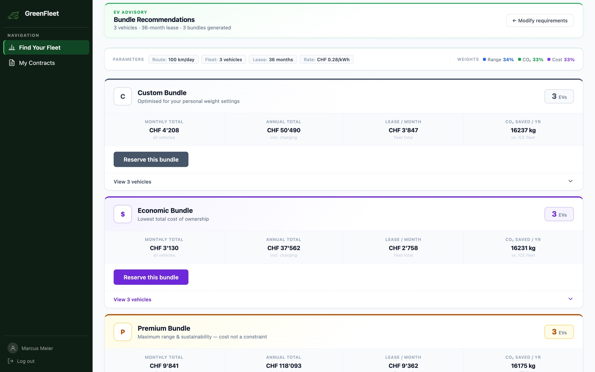
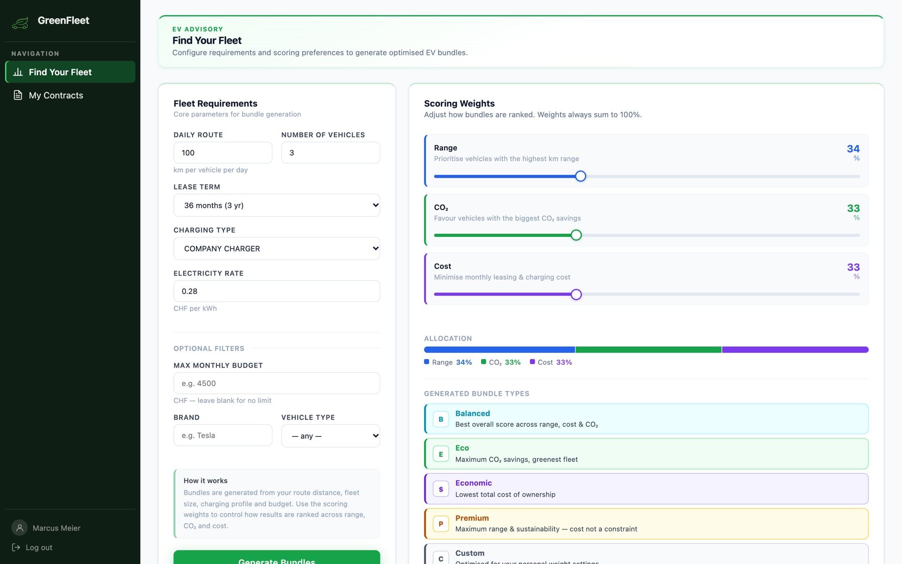
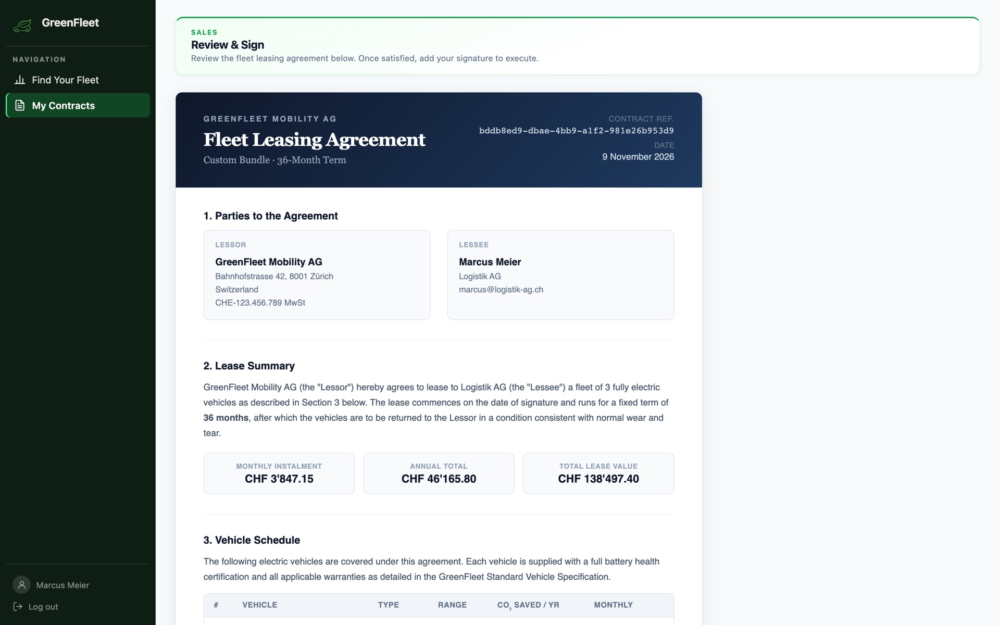
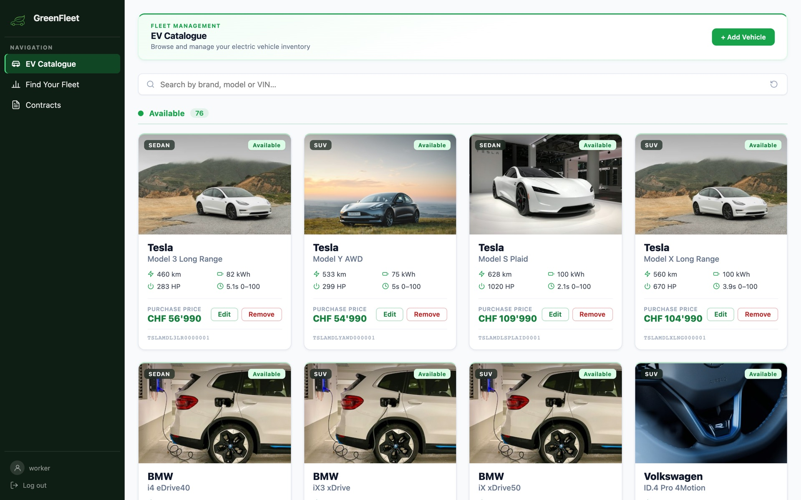
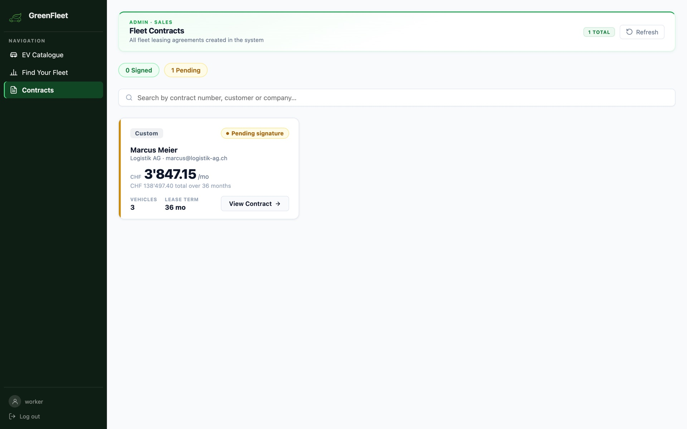

# GreenFleet

   

**An EV fleet leasing platform: companies describe their fleet needs, get scored bundles of electric vehicles and lease them online.**



## Contents

- [Why](#why)
- [What it does](#what-it-does)
- [Screenshots](#screenshots)
- [My contribution](#my-contribution)
- [Quick start](#quick-start)
- [Documentation](#documentation)
- [Team](#team)

## Why

Companies that want to switch their fleet to electric vehicles face many unknowns: which models cover their daily routes, what the switch costs per month including charging, and how much CO₂ it saves. Leasing them usually means comparing offers by hand and signing contracts on paper. GreenFleet turns this into one guided online flow, from requirements to a signed fleet contract.

## What it does

- **Fleet Consulting:** enter daily route, fleet size, lease term, charging setup and electricity price; weight range, CO₂ and cost; get ranked vehicle bundles with monthly cost and yearly CO₂ savings.
- **Sales:** reserve a bundle, review the generated fleet leasing agreement and sign it; employees manage all contracts.
- **EV Catalogue:** employees maintain the vehicle catalogue; vehicle availability updates live (Server-Sent Events) and expired reservations are released automatically.

Built with **Domain-Driven Design** and a **hexagonal architecture** (ports and adapters): three bounded contexts with their own domain models, connected only through explicit ports. See [Architecture](docs/architecture.md).

## Screenshots

| Fleet requirements and scoring weights | Generated fleet leasing agreement |
|---|---|
|  |  |
| **Vehicle catalogue (employee view)** | **Fleet contracts (employee view)** |
|  |  |

## My contribution

I was one of the main contributors to the codebase (most lines of code added in the team). My focus:

- **Sales bounded context:** built the fleet contract lifecycle with its domain model, application services, ports and adapters, and system tests.
- **EV Catalogue:** wrote the unit, integration and system tests for all application services, and later enforced the hexagonal architecture boundaries.
- **Integration:** connected the Fleet Consulting context with the EV Catalogue, and added real-time vehicle status via Server-Sent Events, with automatic release of expired reservations.
- **Code quality:** led the final refactoring across all contexts (naming, dead code, validation and error handling).
- **Frontend:** the sales page and the reservation flow in React.

## Quick start

Requires Java 17 and Node.js 18+. The backend uses an in-memory H2 database and seeds demo vehicles on startup.

```bash
./mvnw spring-boot:run            # backend on http://localhost:8080
cd frontend && npm install && npm run dev   # frontend on http://localhost:5173
```

Log in as a customer with any name, email and company, or as an employee with `worker` / `12345`. Details, Docker setup and configuration: [Getting started](docs/getting-started.md).

## Documentation

| | |
|---|---|
| [Architecture](docs/architecture.md) | Hexagonal architecture, bounded contexts, project structure |
| [Tech stack](docs/tech-stack.md) | Technologies and versions |
| [Getting started](docs/getting-started.md) | Local setup, Docker, configuration |
| [API and authentication](docs/api.md) | Login flows and REST endpoints |
| [Testing](docs/testing.md) | Unit, integration, system, BDD and property-based tests |
| [Deployment](docs/deployment.md) | Docker Compose, Traefik, Let's Encrypt, Nginx |

## Team

Built by a team in a software engineering course, spring 2026:  
Paul Kottmann, Linus Ihringer, Torsten Schmälzle, Valeria Pointet, Kristian Suntev, Nevio Gübeli

---

*Built with Domain-Driven Design · Hexagonal Architecture · Spring Boot · React*
