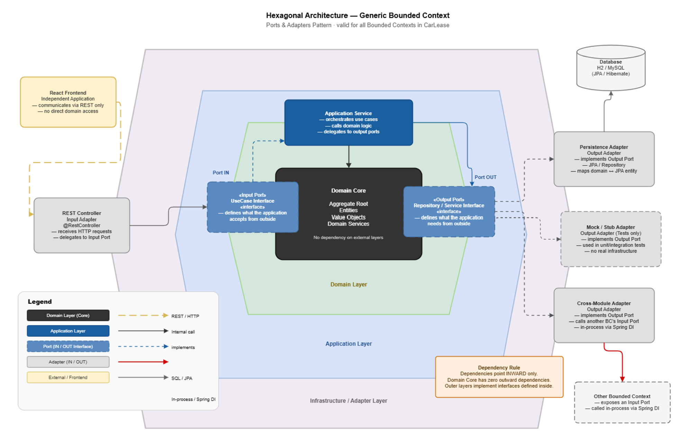
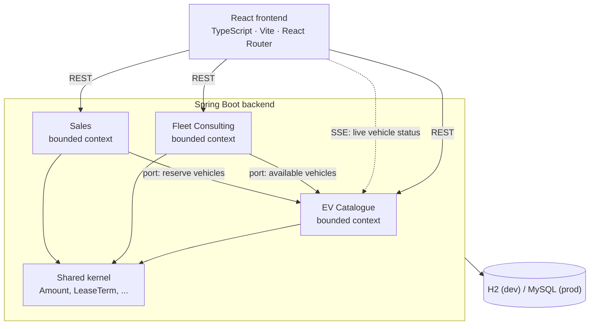

# Architecture



The application is structured around **three independent bounded contexts**, each with its own domain model, application services, and adapter layer. All communication between bounded contexts goes through explicit ports.



Each bounded context follows the same internal layering:

```
adapter/in/web      ←  REST controllers, DTOs, exception handlers
application/port    ←  Use case interfaces (in) and output port interfaces (out)
application/service ←  Application services implementing use cases
adapter/out         ←  Persistence adapters, inter-BC adapters, SSE adapters
domain              ←  Aggregate roots, entities, value objects, domain services
```

## Bounded contexts

### 1. EV Catalogue

Manages the inventory of electric vehicles available for leasing.

**Responsibilities:**
- Add, update, and remove electric vehicles with full technical specifications
- Track vehicle lifecycle status: `AVAILABLE` → `RESERVED` → `UNDER_CONTRACT` → `REMOVED`
- Manage battery health records (state of health, measured range)
- Broadcast real-time status changes to connected clients via Server-Sent Events (SSE)
- Automatically release expired reservation locks via a scheduled job

**Key domain objects:** `Vehicle` (Aggregate Root), `VehicleId`, `VehicleSpecification`, `BatterySpecification`, `ReservationLock`, `VehicleStatus`

---

### 2. Fleet Consulting

The core advisory engine: translates fleet operational requirements into ranked EV bundle recommendations.

**Responsibilities:**
- Accept fleet requirements (daily route km, number of vehicles, lease term, charging setup, optional budget, brand/type filters)
- Score every available vehicle across three dimensions: range suitability, CO₂ savings, and cost
- Allow custom scoring weight allocation (range / CO₂ / cost, always summing to 100%)
- Generate up to five parallel bundle recommendations:

| Bundle Type | Strategy |
|---|---|
| `BALANCED` | Best overall score across all three dimensions |
| `ECO` | Maximum annual CO₂ savings vs. diesel |
| `ECONOMIC` | Lowest total cost of ownership |
| `PREMIUM` | Maximum range and sustainability, cost unconstrained |
| `CUSTOM` | Optimised for the user's own weight settings |

- Calculate full TCO per bundle: monthly lease cost, monthly charging cost, monthly total, annual total
- Compute annual CO₂ savings per vehicle compared to an equivalent ICE fleet

**Key domain objects:** `FleetRequirements`, `FleetBundle`, `ScoredVehicle`, `IndividualVehicleScore`, `ScoringWeights`, `BundleOptimizer`, `TotalCostOfOwnership`, `Co2Impact`

---

### 3. Sales

Manages the full fleet contract lifecycle from bundle reservation through to digital signing.

**Responsibilities:**
- Reserve all vehicles in a selected bundle atomically
- Create fleet leasing contracts with customer details (name, company, email)
- Present the full contract document (parties, lease summary, vehicle schedule, T&C)
- Accept digital handwritten signatures via a canvas-based signature pad
- Transition reserved vehicles to `UNDER_CONTRACT` status on signing
- Automatically release vehicle reservations and delete unsigned contracts on abandonment
- Allow fleet managers (customers) to view and print their own contracts
- Allow GreenFleet employees to view all contracts across all customers

**Key domain objects:** `FleetContract` (Aggregate Root), `VehicleContract`, `Customer`, `ContractNumber`, `SignDate`

## Project structure

```
BSC_FS26_SE_GROUP04/
├── src/
│   ├── main/
│   │   ├── java/io/carlease/
│   │   │   ├── auth/                    # Session-based authentication
│   │   │   ├── config/                  # CORS and web configuration
│   │   │   ├── shared/domain/           # Shared value objects (Amount, LeaseTerm, ...)
│   │   │   ├── EV_Catalogue/            # EV Catalogue bounded context
│   │   │   │   ├── adapter/in/web/      # REST controllers + DTOs
│   │   │   │   ├── adapter/out/         # Persistence + SSE adapters
│   │   │   │   ├── application/         # Use cases (ports) and services
│   │   │   │   └── domain/              # Vehicle aggregate + value objects
│   │   │   ├── fleet_consulting/        # Fleet Consulting bounded context
│   │   │   │   ├── adapter/in/web/      # REST controller + DTOs
│   │   │   │   ├── adapter/out/         # EV Catalogue + Installment adapters
│   │   │   │   ├── application/         # GetRecommendation use case + service
│   │   │   │   └── domain/              # Bundle optimizer, scorer, TCO, CO2 impact
│   │   │   ├── sales/                   # Sales bounded context
│   │   │   │   ├── adapter/in/web/      # Fleet contract REST controller
│   │   │   │   ├── adapter/out/         # Persistence + EV Catalogue adapters
│   │   │   │   ├── application/         # Contract lifecycle use cases + services
│   │   │   │   └── domain/              # FleetContract aggregate, Customer, ...
│   │   └── resources/
│   │       └── application.properties   # App configuration
│   └── test/
│       ├── java/io/carlease/
│       │   ├── ev_catalogue/            # EV Catalogue tests (unit, integration, system)
│       │   ├── fleet_consulting/        # Fleet Consulting tests (unit, property-based, system)
│       │   ├── sales/                   # Sales tests (unit, integration, system, BDD)
│       │   └── shared/                  # Shared domain tests
│       └── resources/features/
│           └── fleet_contract.feature   # Cucumber BDD scenarios
├── frontend/
│   ├── src/
│   │   ├── api/                         # Typed API client modules
│   │   ├── components/                  # Reusable React components
│   │   ├── context/                     # Auth context (React Context API)
│   │   ├── pages/                       # Page components (one per route)
│   │   ├── styles/                      # Global CSS
│   │   ├── types.ts                     # Shared TypeScript types
│   │   ├── App.tsx                      # Root component + routing
│   │   └── main.tsx                     # Entry point
│   ├── package.json
│   └── vite.config.ts
├── docker-compose.yml                   # Production container orchestration
├── nginx.conf                           # Nginx reverse proxy config
├── pom.xml                              # Maven build descriptor
└── mvnw / mvnw.cmd                      # Maven wrapper
```

## Tactical DDD

- **Aggregates** such as `Vehicle` and `FleetContract` enforce their invariants themselves, for example the vehicle state machine and lock rules.
- **Value objects** (`Amount`, `LeaseTerm`, `VehicleId`, `ReservationLock`, ...) are immutable and validate on creation.
- **Repositories** are output ports; the JPA implementations are adapters.
- **Command-query separation** between use cases that change state and those that read it; DTOs at the REST boundary.
- **Cross-context integration** only through inbound ports, with anti-corruption layers; see the [context map](domain.md#context-map).

---

[← Back to the README](../README.md) · [Documentation index](README.md)
