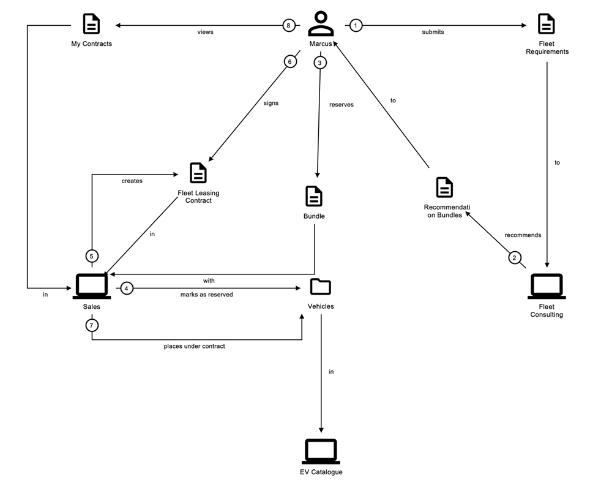
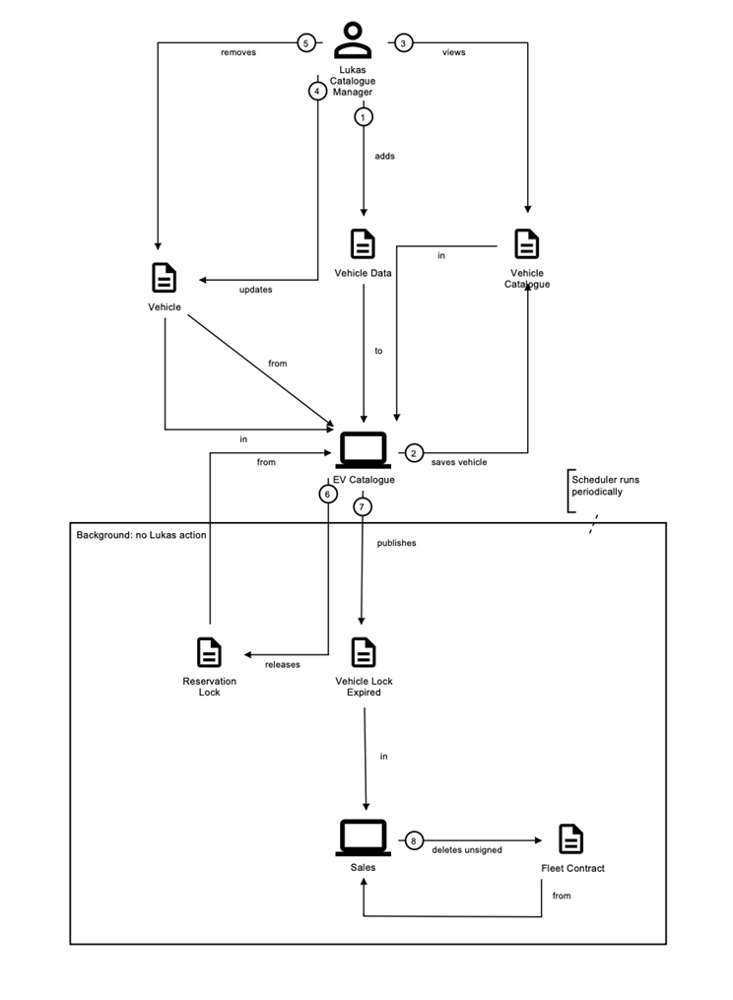
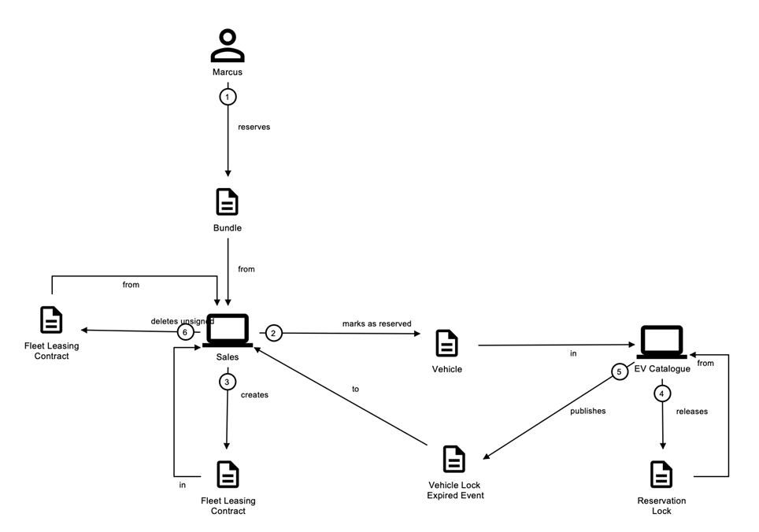
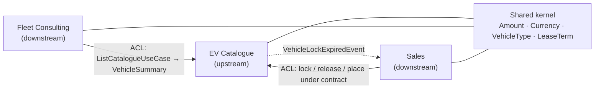
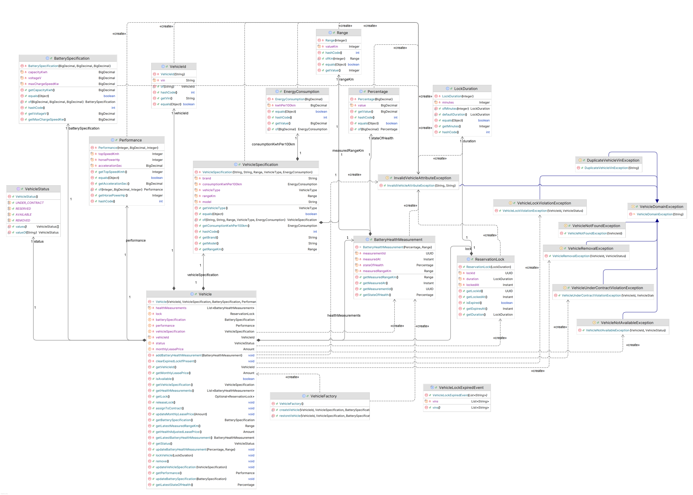
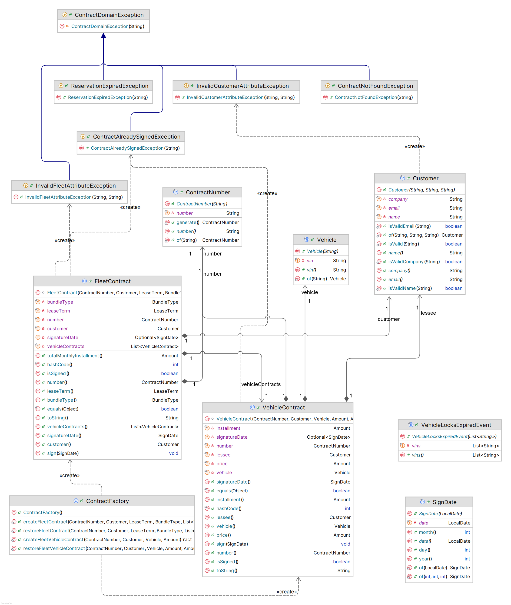
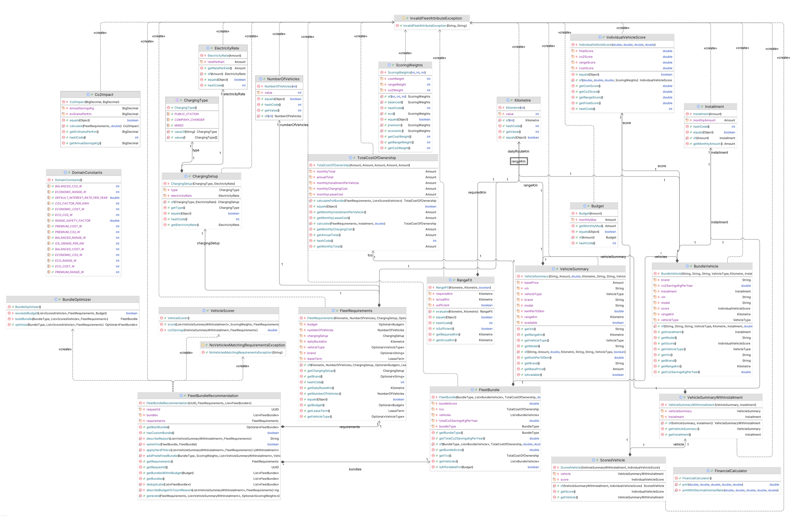

# Domain model

## Domain stories

Domain stories (fine-grained, digitalised, as-is) were the starting point for the domain model.

### Happy path: Marcus, the fleet manager

Marcus submits his fleet requirements, receives recommendation bundles, reserves one, and the vehicles move from `AVAILABLE` to `RESERVED`. Sales creates the fleet leasing contract; after Marcus signs it, the vehicles move to `UNDER_CONTRACT`.

### Lukas, the catalogue manager

### Variation: expired reservation

If a reservation lock expires before the contract is signed, the vehicles become available again and the unsigned contract is removed.

## Ubiquitous language

| Term | Code | Meaning |
|---|---|---|
| Fleet requirements | `FleetRequirements` | Route distance, number of vehicles, budget, lease term and vehicle type entered by a fleet manager |
| Recommendation bundles | `FleetBundleRecommendation` | Vehicle packages matching the requirements: Balanced, Eco, Economic, Premium, Custom |
| Bundle | `BundleType` | The recommendation a fleet manager reserves |
| Fleet contract | `FleetContract` | Leasing agreement between a customer and GreenFleet for a reserved bundle |
| Vehicle | `Vehicle` | An electric vehicle in the catalogue, identified by its VIN |
| Reservation lock | `ReservationLock` | Temporary lock on a reserved vehicle, 15 minutes by default |
| Vehicle lock expired | `VehicleLockExpiredEvent` | Domain event when a lock expires; Sales then deletes unsigned contracts |

## Bounded contexts

| Context | Responsibility | Not responsible for |
|---|---|---|
| **EV Catalogue** (upstream) | Vehicle inventory, lifecycle `AVAILABLE → RESERVED → UNDER_CONTRACT`, reservation locks with expiry, battery-health-adjusted lease prices, live status via Server-Sent Events, `VehicleLockExpiredEvent` | Contracts, recommendations, deciding which vehicles go into a contract |
| **Fleet Consulting** (downstream) | Fleet requirements, vehicle scoring and ranking, total cost of ownership incl. charging and CO₂, bundle assembly; stateless | Vehicle data and availability, contract creation |
| **Sales** (downstream) | Fleet contracts with customer, lease term and vehicles; reservation and release within a contract; signing; customer and employee views; removing unsigned contracts after lock expiry | Vehicle data, recommendations, authentication |

### Context map

- **Upstream/downstream:** EV Catalogue knows nothing about its consumers; Sales and Fleet Consulting read vehicle data and trigger state changes only through its inbound ports.
- **Anti-corruption layers:** Sales works with plain VIN strings, and its adapters translate them into EV Catalogue's `VehicleId` and add the lock duration. Fleet Consulting translates catalogue vehicles into its own `VehicleSummary` model, converting units and flattening value objects.
- **Shared kernel:** only context-neutral value objects are shared, to keep coupling low.

## BDD scenarios

Each bounded context was specified with Given–When–Then scenarios before implementation. The fleet contract lifecycle runs as an executable Cucumber feature: [`fleet_contract.feature`](../src/test/resources/features/fleet_contract.feature).

## UML class diagrams

### EV Catalogue

### Sales

### Fleet Consulting

---

[← Back to the README](../README.md) · [Documentation index](README.md)
