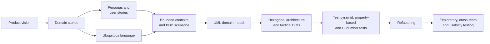

# Software engineering process

GreenFleet was built over one semester following a domain-driven, test-driven process. Each step produced an artefact that fed the next one:

| Step | Artefacts | Document |
|---|---|---|
| 1. Product vision | Vision statement, strategic intention, seven core features | [Vision](vision.md) |
| 2. Domain discovery | Three domain stories, ubiquitous language | [Domain model](domain.md#domain-stories) |
| 3. Requirements | Two personas, 25 user stories | [Requirements](requirements.md) |
| 4. Domain model | Bounded context scopes, context map, BDD scenarios, UML class diagrams | [Domain model](domain.md) |
| 5. Architecture | Hexagonal architecture, aggregates, value objects, anti-corruption layers | [Architecture](architecture.md) |
| 6. Quality | Test pyramid with 337 tests, property-based tests, Cucumber lifecycle test | [Testing](testing.md) |
| 7. Reliable programming | Four refactorings, below | [Refactoring](#refactoring) |
| 8. Validation | Own, cross-team and usability testing | [Testing](testing.md#exploratory-and-usability-testing) |

## Ways of working

- **Kanban and pull requests:** all work was tracked on a Kanban board and merged through pull requests. Nobody merged their own pull request; every change was reviewed by at least one other team member, later with a PR checklist for DDD boundaries, domain exceptions and test coverage.
- **Pair programming:** used for every domain model implementation, where mistakes are expensive; other work was done individually with fast test feedback.
- **CI/CD:** GitHub Actions builds and tests the backend, builds the frontend, deploys with Docker Compose and runs a live health check after deployment. Secrets such as the image API key are injected at build time.
- **Retrospectives:** a ten-minute four-quadrant retrospective every week. Two concrete results: a short agenda before each session, and the PR checklist.

## Refactoring

Refactoring was continuous: every pull request was reviewed for it, and findings went onto the Kanban board. The four most important cases:

1. **Feature envy:** the `FinancialCalculator` lived in Sales but only served Fleet Consulting. It was moved into the Fleet Consulting domain, which removed a cross-context dependency.
2. **Automatic lock release:** manual release of vehicle reservations proved unreliable. A scheduled job now releases expired locks; the manual release chain was deleted (−480 lines).
3. **Event-driven contract cleanup:** releasing a lock could leave an unsigned contract pointing to vehicles that were no longer reserved. EV Catalogue now publishes a `VehicleLockExpiredEvent`, and Sales deletes the affected unsigned contracts. A data-consistency bug became an explicit, testable domain event flow.
4. **Decomposing `Vehicle.lockVehicle`:** clearing an expired lock and acquiring a new one were split into separate, individually tested steps.

Together these refactorings removed more than 1,300 lines while increasing test coverage.

---

[← Back to the README](../README.md) · [Documentation index](README.md)
